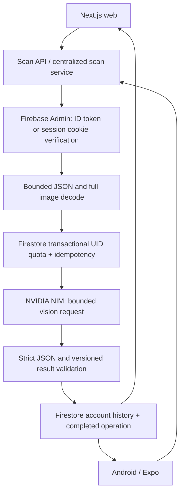

# Backend architecture audit — 2026-11-16

Baseline: 91cdbb9. Local inspection and repairs; no deployment.

Other public entries: auth/mobile (guest, password, refresh, authorized email linking), auth/login (session cookies), auth/logout (POST local logout), auth/bridge (one-use verifier-protected exchange), history GET/DELETE, profile GET/PATCH. The analysis module no longer exports server actions. No background jobs were found.

Trust boundaries: all client inputs, headers, images and model content are untrusted. Firebase claims establish UID and anonymous provider. Admin access bypasses Firestore rules, so routes derive every account path from verified identity. Submitted images are transient, normalized, stripped of metadata and sent to NVIDIA; they are not persisted. Analysis records are account-owned. No shared image cache remains.

Threats addressed: forged guest credentials, public action invocation, quota races, duplicate charging, cross-account history, OAuth redirect credential leakage, malformed images, truncated AI JSON, unknown assessments presented as facts. Remaining risks: anonymous-account farming needs deployment-level abuse controls; authentication/signup and provider spending need operational monitoring. No production configuration or Firestore rules were read from the live project.
